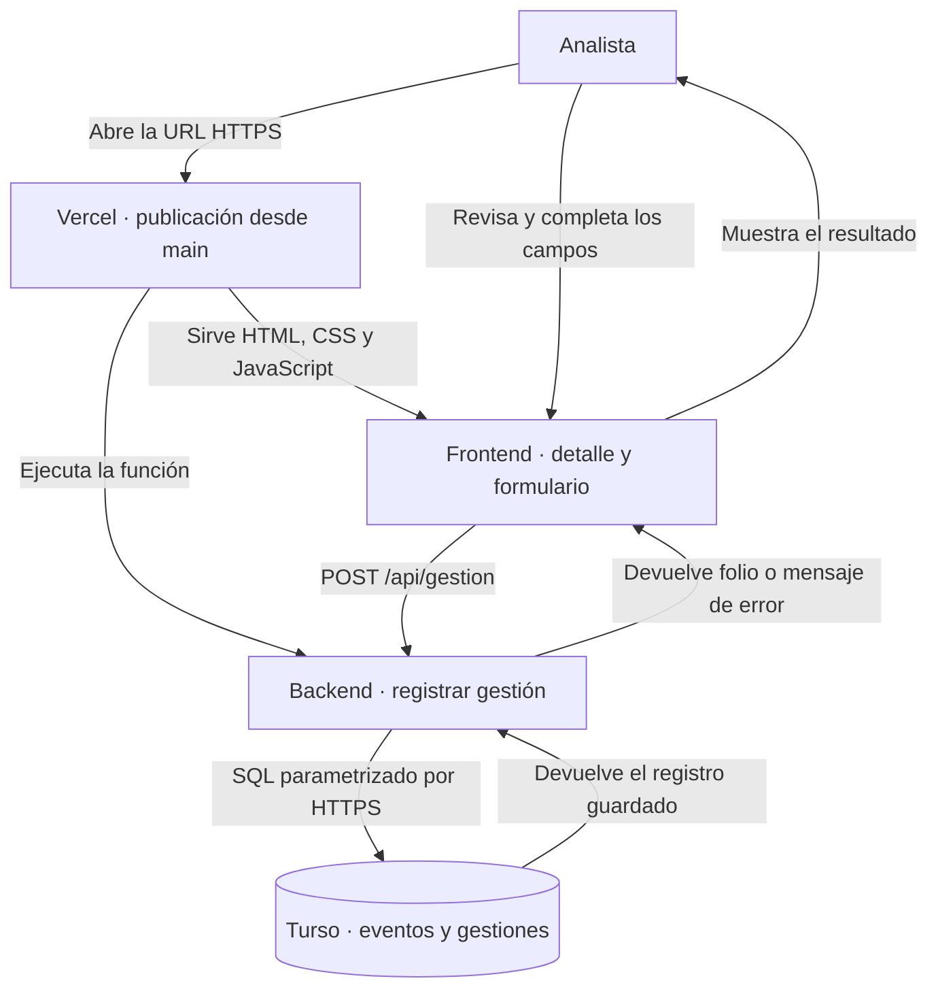

# Arquitectura y PoC de Aqua Trace

Equipo 7 · Ingeniería Digital en Acción · USACH

## Diagrama de componentes



| Pieza | Qué hace en Aqua Trace | Con qué está hecha | Con quién se comunica |
|---|---|---|---|
| Frontend | Muestra dos eventos ficticios y su respaldo. Recoge la acción realizada, el resultado de la revisión y el comentario. Presenta el folio o el error. | HTML, CSS y JavaScript en `src/public/`. | Analista, Vercel y backend. |
| Backend | Comprueba que la acción y el resultado sean compatibles y que el comentario sea válido. Permite guardar solo en un evento con respaldo suficiente y devuelve el registro por su folio. | Función HTTP de Node.js 24. La lógica está en `src/gestion.mjs` y el punto de entrada para Vercel en `api/gestion.mjs`. | Frontend y base de datos. |
| Datos y servicio externo | Guarda el historial de gestiones con una referencia al evento. Mantiene la condición de respaldo de cada evento de ejemplo. | Turso (SQLite administrado) en Vercel y un archivo SQLite en local. Esquema y ejemplos en `src/datos.sql`. | Backend mediante SQL parametrizado. |
| Publicación | Sirve el formulario por HTTPS y ejecuta la función de registro. | Vercel vinculado a la rama de producción `main`. Configuración en `vercel.json`. | GitHub, navegador y función de registro. |

Si Turso no responde, la pantalla avisa que el guardado no pudo confirmarse y conserva los datos en el formulario. El analista puede reintentar con el mismo folio mientras mantenga el envío en ese formulario. Si la base ya había guardado la primera solicitud, el backend devuelve el mismo registro y evita duplicarlo.

## Camino delgado

**Acción.** Registrar una gestión sobre una anomalía con respaldo suficiente y mostrar el folio asociado al evento. Corresponde a HU-03 y verifica el vínculo de trazabilidad descrito en HU-04.

**Supuesto técnico.** La decisión tomada después de revisar los antecedentes debe quedar asociada al evento correcto. Si el sistema admite una gestión sin respaldo o pierde la relación con el evento, el siguiente turno no puede reconstruir lo ocurrido a partir del registro. Por eso la comprobación se hace en el servidor al momento de guardar.

**Alcance.** Se usan dos eventos ficticios y la comparación de lecturas se presenta como evidencia precargada. Quedan para etapas siguientes la detección automática, la lectura de fuentes reales, la carga de archivos, el inicio de sesión, la emisión de tickets, el cambio de estado en la base y el tablero. «Ticket requerido» puede quedar registrado como decisión del analista para una etapa posterior.

**Respuesta ante errores.** Para un comentario vacío se muestra «Escribe por qué tomaste esta decisión» debajo del campo. Para el evento 7002 se muestra el estado «Pendiente» y el mensaje «Se requieren antecedentes adicionales para continuar». Una petición directa con ese evento también se rechaza en el backend.

## Evidencia

| Prueba | Resultado observado en local |
|---|---|
| Enviar acción, resultado y comentario válidos para el evento 7001 | HTTP 201. El backend devuelve un folio vinculado al evento. Al reabrir el archivo SQLite se recupera el mismo registro. |
| Enviar solo espacios como comentario | HTTP 422. El backend devuelve el mensaje asociado al campo. No se crea un registro. |
| Enviar directamente una solicitud válida para el evento 7002 | HTTP 409. Se requieren antecedentes adicionales. No se crea un registro. |
| Repetir el mismo folio con los mismos datos | HTTP 200. Devuelve el registro original y la base conserva una sola fila para ese folio. |
| Simular un fallo de conexión con la base | HTTP 503. Se puede reintentar y el servidor devuelve un mensaje sin confirmar el guardado. |

Ejecutar `npm test` para repetir las pruebas. Para la comprobación en el despliegue, se puede enviar el caso de respaldo insuficiente desde la consola del navegador abierto en la URL de la PoC:

```js
const respuesta = await fetch('/api/gestion', {
  method: 'POST',
  headers: { 'Content-Type': 'application/json' },
  body: JSON.stringify({
    folio: crypto.randomUUID(),
    id_evento: 7002,
    accion: 'Validar evento',
    resultado: 'Sin ticket',
    comentario: 'Prueba con un evento ficticio'
  })
});
console.log(respuesta.status, await respuesta.json());
```

Para comprobar el caso exitoso en la base, copia el folio de pantalla y consulta `SELECT * FROM gestion WHERE folio = 'FOLIO_COPIADO';` en la consola SQL de la base de prueba.

**Dirección pública y video.** 
Dirección pública: https://proyecto-pozos-app.vercel.app

La PoC fue probada en producción con el evento 7001, obteniendo un folio asociado al registro guardado en Turso. También se verificó el rechazo por comentario vacío y el bloqueo del evento 7002 por respaldo insuficiente.

Video: https://drive.google.com/file/d/18-KrztY35g75AMe-iVTkiagLQ9COtO_B/view


