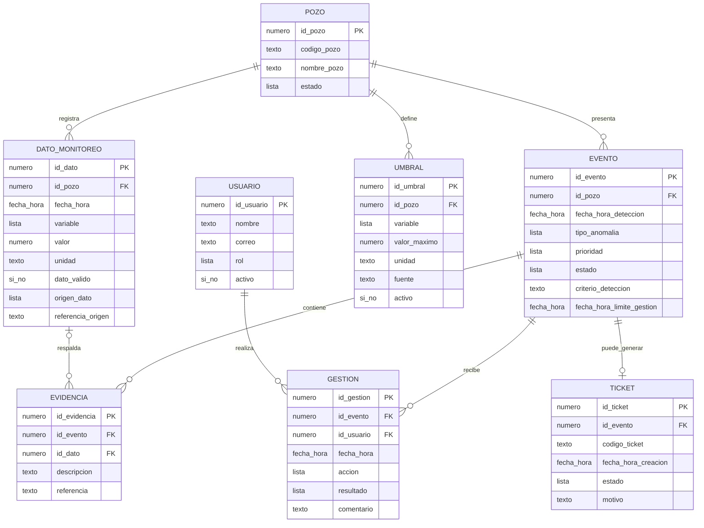

# Estructura de datos preliminar

## 1. Diagrama preliminar de la base de datos

La estructura se construyó a partir de los conceptos presentes en el caso de uso principal del proyecto: usuario/analista, pozo, datos de monitoreo, evento detectado, evidencia, gestión y ticket.

### Relaciones y cardinalidad

| Relación | Cardinalidad | Explicación |
|---|---|---|
| POZO - DATO_MONITOREO | 1:N | Un pozo puede tener muchos registros de monitoreo y cada registro pertenece a un solo pozo. |
| POZO - EVENTO | 1:N | Un pozo puede presentar varios eventos detectados en distintos momentos. |
| EVENTO - EVIDENCIA | 1:N | Un evento puede conservar una o más evidencias asociadas. |
| DATO_MONITOREO - EVIDENCIA | 0..1:N | Una evidencia puede estar asociada a un dato de monitoreo cuando este existe. En casos como un registro faltante, la evidencia puede no tener un dato asociado. Un dato puede utilizarse como respaldo de una o más evidencias. |
| EVENTO - GESTION | 1:N | Un evento puede recibir varias acciones o revisiones durante su seguimiento. |
| USUARIO - GESTION | 1:N | Un usuario puede realizar varias gestiones y cada gestión queda asociada al responsable que la ejecutó. |
| EVENTO - TICKET | 1:1 (opcional) | Un evento puede no generar ticket; cuando corresponde, queda asociado a un ticket dentro del flujo definido actualmente. |
| POZO - UMBRAL | 1:N | Un pozo puede tener uno o más límites definidos según la variable monitoreada. |

> Nota: el modelo es preliminar. Las cardinalidades y campos podrán ajustarse cuando se construya el PoC y se validen las necesidades reales de almacenamiento.

---

## 2. Tablas, campos obligatorios y ejemplos

El símbolo `*` identifica un campo obligatorio.

Los registros incluidos a continuación son ejemplos ilustrativos utilizados para representar la estructura preliminar y no corresponden a información operacional real.

### Tabla: USUARIO

| Campo | Tipo | Clave | Obligatorio | Descripción |
|---|---|---|---|---|
| id_usuario* | número | primaria | Sí | Identificador único del usuario. |
| nombre* | texto | - | Sí | Nombre del analista o responsable. |
| correo* | texto | - | Sí | Correo del usuario. |
| rol* | lista | - | Sí | Rol dentro del proceso, por ejemplo Analista o Supervisor. |
| activo* | sí o no | - | Sí | Indica si el usuario está habilitado. |

**Ejemplos de registros**

| id_usuario* | nombre* | correo* | rol* | activo* |
|---:|---|---|---|---|
| 1 | Ana Torres | ana.torres@ejemplo.cl | Analista | Sí |
| 2 | Luis Rojas | luis.rojas@ejemplo.cl | Supervisor | Sí |

### Tabla: POZO

| Campo | Tipo | Clave | Obligatorio | Descripción |
|---|---|---|---|---|
| id_pozo* | número | primaria | Sí | Identificador interno del pozo. |
| codigo_pozo* | texto | - | Sí | Código con que se identifica el pozo. |
| nombre_pozo* | texto | - | Sí | Nombre usado para reconocer el pozo. |
| estado* | lista | - | Sí | Estado general del pozo dentro del sistema. |

**Ejemplos de registros**

| id_pozo* | codigo_pozo* | nombre_pozo* | estado* |
|---:|---|---|---|
| 101 | OB-0202-251 | PBO-01-C | Activo |
| 102 | OB-0202-252 | Pozo 252 | Activo |

### Tabla: DATO_MONITOREO

| Campo | Tipo | Clave | Obligatorio | Descripción |
|---|---|---|---|---|
| id_dato* | número | primaria | Sí | Identificador único del registro. |
| id_pozo* | número | externa | Sí | Pozo al que pertenece el dato. |
| fecha_hora* | fecha y hora | - | Sí | Momento en que se registró la medición. |
| variable* | lista | - | Sí | Variable monitoreada. |
| valor* | número | - | Sí | Valor registrado. |
| unidad* | texto | - | Sí | Unidad de medida asociada al valor. |
| dato_valido* | sí o no | - | Sí | Indica si el dato puede utilizarse en el análisis. |
| origen_dato* | lista | - | Sí | Fuente desde la que se obtuvo el registro. |
| referencia_origen | texto | - | No | Archivo, sistema o referencia desde donde se obtuvo el dato. |

**Ejemplos de registros**

| id_dato* | id_pozo* | fecha_hora* | variable* | valor* | unidad* | dato_valido* | origen_dato* | referencia_origen |
|---:|---:|---|---|---:|---|---|---|---|
| 5001 | 101 | 2026-09-30 10:00 | Caudal | 0,72 | L/s | Sí |DGA | registros_pozo_2026_09.csv |
| 5002 | 102 | 2026-09-30 09:00 | Caudal | 0,18 | L/s | Sí | DGA | registros_pozo_2026_09.csv |

### Tabla: EVENTO

| Campo | Tipo | Clave | Obligatorio | Descripción |
|---|---|---|---|---|
| id_evento* | número | primaria | Sí | Identificador del evento detectado. |
| id_pozo* | número | externa | Sí | Pozo donde se detectó el evento. |
| fecha_hora_deteccion* | fecha y hora | - | Sí | Momento en que se generó o detectó el evento. |
| tipo_anomalia* | lista | - | Sí | Tipo de anomalía detectada. |
| prioridad* | lista | - | Sí | Nivel de prioridad para su revisión. |
| estado* | lista | - | Sí | Estado de revisión del evento. |
| criterio_deteccion* | texto | - | Sí | Regla o condición que provocó la detección del evento. |
| fecha_hora_limite_gestion | fecha y hora | - | No | Fecha y hora límite definida para gestionar el evento cuando corresponda. |

**Estados del evento**

El estado del evento cambia de acuerdo con el avance de su revisión:

- **Pendiente:** el sistema detectó la anomalía, pero todavía no ha sido revisada por un analista.
- **En revisión:** un analista está revisando el evento y su evidencia.
- **Gestionado:** el analista ya tomó una decisión y quedó registrada una gestión. Si corresponde, puede existir un ticket asociado.
- **Cerrado:** el evento terminó su ciclo de gestión y no requiere acciones pendientes.

**Ejemplos de registros**

| id_evento* | id_pozo* | fecha_hora_deteccion* | tipo_anomalia* | prioridad* | estado* | criterio_deteccion* | fecha_hora_limite_gestion |
|---:|---:|---|---|---|---|---|---|
| 7001 | 101 | 2026-09-30 10:05 | Sobreflujo de caudal | Alta | Gestionado | Caudal 0,72 L/s superior al máximo 0,60 L/s definido para el pozo | 2026-10-03 10:05 |
| 7002 | 102 | 2026-09-30 10:05 | Dato faltante | Media | Gestionado | No existe lectura registrada para la hora esperada | 2026-10-03 10:05 |

### Tabla: EVIDENCIA

| Campo | Tipo | Clave | Obligatorio | Descripción |
|---|---|---|---|---|
| id_evidencia* | número | primaria | Sí | Identificador único de la evidencia. |
| id_evento* | número | externa | Sí | Evento respaldado por la evidencia. |
| id_dato | número | externa | No | Registro de monitoreo utilizado como respaldo cuando existe un dato asociado. Puede quedar vacío cuando la evidencia corresponde a un registro faltante. |
| descripcion* | texto | - | Sí | Explicación breve de la evidencia. |
| referencia* | texto | - | Sí | Referencia al dato, archivo o recurso utilizado. |

**Ejemplos de registros**

| id_evidencia* | id_evento* | id_dato | descripcion* | referencia* |
|---:|---:|---:|---|---|
| 8001 | 7001 | 5001 | Registro de caudal utilizado para comprobar la superación del límite definido. | dato:5001 |
| 8002 | 7002 | - | No existe lectura registrada para la hora esperada del pozo. | ausencia:2026-09-30_10:00 |

### Tabla: GESTION

| Campo | Tipo | Clave | Obligatorio | Descripción |
|---|---|---|---|---|
| id_gestion* | número | primaria | Sí | Identificador de la acción realizada. |
| id_evento* | número | externa | Sí | Evento sobre el cual se realizó la gestión. |
| id_usuario* | número | externa | Sí | Usuario responsable de la acción. |
| fecha_hora* | fecha y hora | - | Sí | Momento en que se realizó la gestión. |
| accion* | lista | - | Sí | Tipo de acción ejecutada. |
| resultado* | lista | - | Sí | Resultado de la revisión. |
| comentario* | texto | - | Sí | Observación que explica la gestión realizada. |

**Ejemplos de registros**

| id_gestion* | id_evento* | id_usuario* | fecha_hora* | accion* | resultado* | comentario* |
|---:|---:|---:|---|---|---|---|
| 8501 | 7001 | 1 | 2026-09-30 10:20 | Validar evento | Ticket requerido | Se mantiene la condición detectada y se solicita gestionar ticket. |
| 8502 | 7002 | 1 | 2026-09-30 10:25 | Validar evento | Ticket requerido | Se confirma que la lectura debe ser revisada mediante ticket. |

### Tabla: UMBRAL

Esta tabla almacena los límites utilizados por el sistema para comparar las mediciones de cada pozo. Para el caso de caudal, los valores provienen del archivo de límites utilizado en el proceso de monitoreo.

| Campo | Tipo | Clave | Obligatorio | Descripción |
|---|---|---|---|---|
| id_umbral* | número | primaria | Sí | Identificador único del límite. |
| id_pozo* | número | externa | Sí | Pozo al que corresponde el límite. |
| variable* | lista | - | Sí | Variable sobre la cual se aplica el límite. |
| valor_maximo* | número | - | Sí | Valor máximo utilizado para la comparación. |
| unidad* | texto | - | Sí | Unidad en que se expresa el límite. |
| fuente* | texto | - | Sí | Referencia al origen desde donde se obtuvo el límite. |
| activo* | sí o no | - | Sí | Indica si el límite se encuentra vigente para el análisis. |

**Ejemplos de registros**

| id_umbral* | id_pozo* | variable* | valor_maximo* | unidad* | fuente* | activo* |
|---:|---:|---|---:|---|---|---|
| 3001 | 101 | Caudal | 0,60 | L/s | limites_dga.xlsx | Sí |
| 3002 | 102 | Caudal | 0,20 | L/s | limites_dga.xlsx | Sí |

### Tabla: TICKET

| Campo | Tipo | Clave | Obligatorio | Descripción |
|---|---|---|---|---|
| id_ticket* | número | primaria | Sí | Identificador interno del ticket. |
| id_evento* | número | externa | Sí | Evento que dio origen al ticket. |
| codigo_ticket* | texto | - | Sí | Código con que se identifica el ticket. |
| fecha_hora_creacion* | fecha y hora | - | Sí | Fecha y hora de registro del ticket. |
| estado* | lista | - | Sí | Estado actual del ticket. |
| motivo* | texto | - | Sí | Razón por la que se generó el ticket. |

**Ejemplos de registros**

| id_ticket* | id_evento* | codigo_ticket* | fecha_hora_creacion* | estado* | motivo* |
|---:|---:|---|---|---|---|
| 9001 | 7001 | TICKET-EJ-001 | 2026-09-30 10:30 | Generado | Revisión de evento por sobreflujo de caudal. |
| 9002 | 7002 | TICKET-EJ-002 | 2026-09-30 10:35 | Generado | Revisión de evento por dato faltante. |

## 3. Valores definidos para campos tipo lista

Para evitar que un mismo concepto sea registrado con nombres distintos, se definen los siguientes valores para los campos de tipo lista utilizados en el modelo.

| Tabla | Campo | Valores permitidos |
|---|---|---|
| USUARIO | rol | Analista, Supervisor |
| POZO | estado | Activo, Inactivo |
| UMBRAL | variable | Caudal, Totalizador, Nivel, pH, Conductividad, Batería |
| DATO_MONITOREO | variable | Caudal, Totalizador, Nivel, pH, Conductividad, Batería |
| DATO_MONITOREO | origen_dato | DGA, LI-COR, OSP_MANUAL |
| EVENTO | tipo_anomalia | Sobreflujo de caudal, Dato faltante, Lectura en cero, Duplicado, Inconsistencia de totalizador, Cambio brusco |
| EVENTO | prioridad | Alta, Media, Baja |
| EVENTO | estado | Pendiente, En revisión, Gestionado, Cerrado |
| GESTION | accion | Validar evento, Descartar evento, Solicitar antecedentes, Registrar observación |
| GESTION | resultado | Ticket requerido, Sin ticket, Pendiente de antecedentes, Evento descartado |
| TICKET | estado | Generado, En gestión, Cerrado |

Los valores de `UMBRAL.variable` y `DATO_MONITOREO.variable` utilizan la misma nomenclatura para permitir la comparación directa entre una medición y su límite cuando corresponda.

