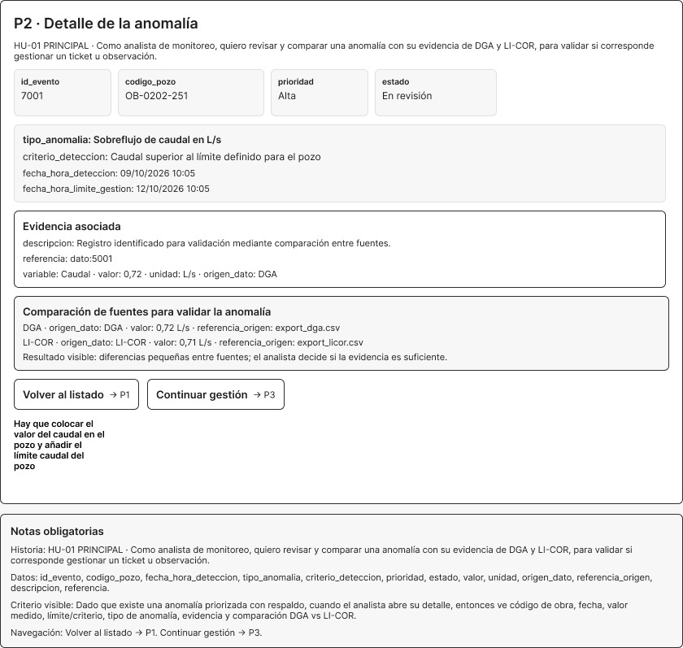
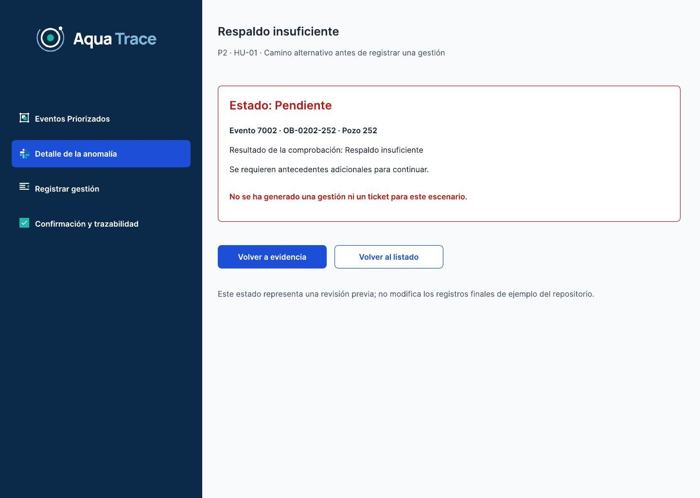
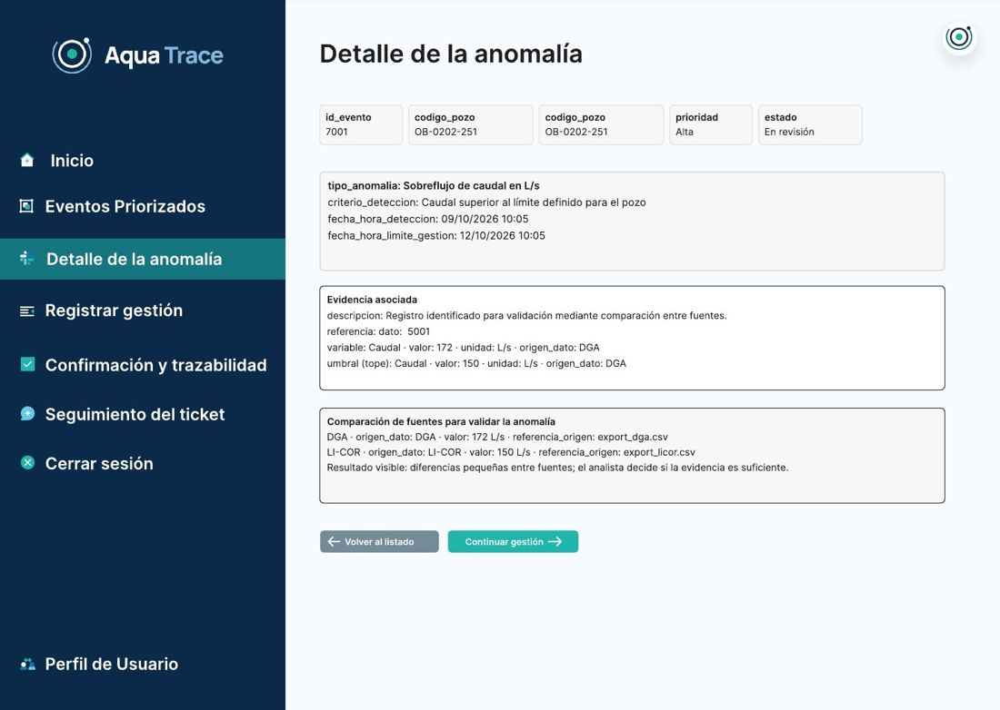
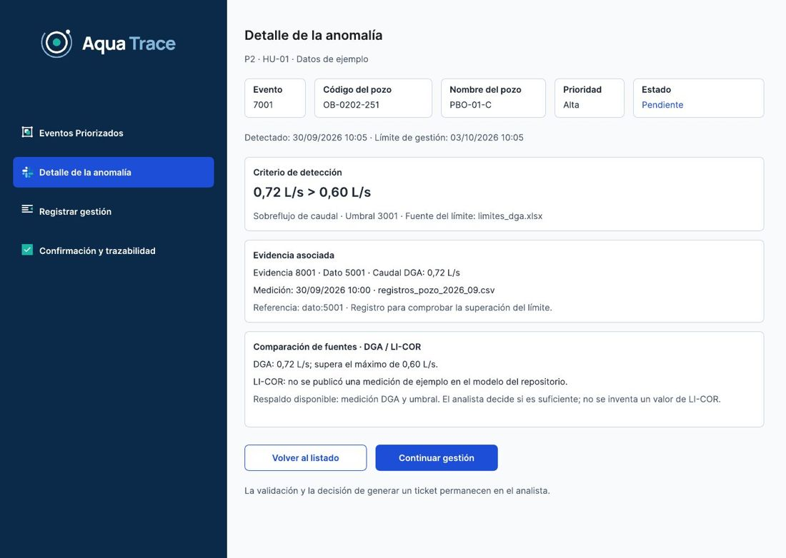

# Análisis ético del prototipo · Aqua Trace

El presente análisis se aplica al prototipo Aqua Trace, diseñado para apoyar la revisión, priorización y trazabilidad de anomalías detectadas en el monitoreo de pozos.

La solución busca disminuir la revisión manual de grandes volúmenes de datos, pero mantiene la validación humana antes de registrar una gestión o generar un ticket.

## B1 · Mapa de impacto y exclusión

|  | Quien ejecuta: Analista de monitoreo | Quien decide o supervisa: Supervisor o jefatura | Quien queda excluido: Personal operativo de terreno sin acceso directo |
|---|---|---|---|
| **Deja de hacer** | Deja de revisar manualmente todos los registros para encontrar anomalías una por una. | Deja de depender únicamente de antecedentes dispersos para conocer el estado de los eventos y gestiones. | No deja de realizar una tarea dentro de la plataforma, porque actualmente no utiliza directamente este sistema. |
| **Su rol cambia** | Pasa a concentrarse en revisar las anomalías detectadas y priorizadas, validar la evidencia disponible y decidir la gestión correspondiente. | Pasa a supervisar los casos, revisar excepciones y comprobar que las decisiones queden respaldadas y trazables. | Su rol no cambia directamente dentro de la plataforma mientras no exista un mecanismo para incorporar sus observaciones de terreno. |
| **Riesgo** | Puede confiar demasiado en la priorización realizada por el sistema y disminuir la revisión crítica de los casos. | Puede tomar una decisión basada en información incompleta si no revisa los antecedentes disponibles. | Una condición detectada físicamente en terreno puede no quedar registrada en los datos y, por lo tanto, no aparecer en el sistema. |

### Medida para quien queda excluido

Cuando una condición relevante sea detectada por personal de terreno y no se encuentre representada en los datos digitales, se deberá mantener un canal operacional complementario para comunicarla al analista de monitoreo.

La observación podrá utilizarse como antecedente adicional durante la revisión del evento, evitando que la plataforma se transforme en la única fuente disponible para tomar decisiones.

## B2 · Ficha de tratamiento de datos

El formulario de registro de gestión utiliza únicamente los campos necesarios para que el analista pueda dejar trazabilidad de la revisión realizada.

Los datos `id_evento` y `fecha_hora_limite_gestion` pueden mostrarse en la pantalla como información de contexto, pero no requieren ser ingresados manualmente por la persona usuaria.

| Campo del formulario | Finalidad | Historia que lo justifica | Quién tiene acceso | Conservación |
|---|---|---|---|---|
| `accion` | Identificar la acción realizada por el analista sobre el evento revisado. | HU-03 · Registrar el resultado de la revisión. | Analista de monitoreo y supervisor autorizado. | Para el prototipo se considera su conservación junto al evento hasta 12 meses después de su cierre. |
| `resultado` | Registrar el resultado de la revisión y permitir conocer qué decisión se adoptó sobre el evento. | HU-03 · Registrar el resultado de la revisión. | Analista de monitoreo y supervisor autorizado. | Para el prototipo se considera su conservación junto al evento hasta 12 meses después de su cierre. |
| `comentario` | Dejar el antecedente o justificación que respalda la decisión adoptada por el analista. | HU-03 · Registrar el resultado de la revisión. | Analista de monitoreo y supervisor autorizado. | Para el prototipo se considera su conservación junto al evento hasta 12 meses después de su cierre. |

### Minimización de datos

El formulario no solicita nombre, RUT, teléfono u otros antecedentes personales que no sean necesarios para realizar la gestión.

La identidad del usuario responsable se asociará mediante el usuario autenticado del sistema y no deberá ser escrita manualmente en el formulario.

El campo `comentario` se utilizará únicamente para antecedentes necesarios para justificar la gestión. Se deberá evitar incorporar nombres, datos de contacto u otra información personal que no sea necesaria para comprender la decisión.

### Criterio de conservación

El plazo de 12 meses posteriores al cierre del evento se utiliza como **criterio preliminar para el prototipo** y no representa todavía una política definitiva de conservación de Codelco o Unisource.

Antes de utilizar datos operacionales reales, este plazo deberá revisarse con el responsable de la información y ajustarse a las políticas aplicables al proceso.

## B3 · Sesgo, accesibilidad y transparencia

La revisión se realizó sobre la versión navegable del prototipo Aqua Trace disponible en Figma.

### Accesibilidad

| Aspecto revisado | Aplicación en el prototipo |
|---|---|
| Tamaño de elementos interactivos | Los botones y controles navegables del flujo principal mantienen áreas interactivas de al menos 24 x 24 px. |
| Estados mediante texto y color | Los estados se identifican mediante texto, por ejemplo `Pendiente`, `En revisión` y `Generado`, evitando depender únicamente del color. |
| Etiquetas visibles | Los campos de Registrar gestión mantienen etiquetas visibles y redactadas para la persona usuaria: «Acción realizada», «Resultado de la revisión» y «Comentario de la decisión». |
| Navegación | Las pantallas principales incluyen acciones visibles para avanzar o regresar dentro del flujo. |
| Contraste | Cumple en todos los elementos activos del flujo principal; el detalle de las mediciones se presenta en la tabla siguiente. |

#### Revisión de contraste

Se midió la razón de contraste entre texto y fondo sobre la exportación del prototipo, siguiendo la fórmula de WCAG 2.1 y exigiendo 4,5:1 para texto normal.

| Elemento | Texto | Fondo | Contraste | Resultado |
|---|---|---|---|---|
| Botones primarios y ítem activo del menú | `#FFFFFF` | `#1D4ED8` | 6,70:1 | Cumple |
| Botones secundarios (con contorno) | `#1D4ED8` | `#FFFFFF` | 6,70:1 | Cumple |
| Menú lateral | `#FFFFFF` | `#0B2A4A` | 14,54:1 | Cumple |
| Texto principal | `#1F2937` | `#FFFFFF` / `#F8FAFC` | 14,68:1 / 14,03:1 | Cumple |
| Texto secundario | `#475569` | `#FFFFFF` / `#F8FAFC` | 7,58:1 / 7,24:1 | Cumple |
| Mensajes de alerta y error | `#B91C1C` | `#FFFFFF` / `#F8FAFC` | 6,47:1 / 6,18:1 | Cumple |
| Botones «Todos los pozos» y «Ninguno» en el estado Cargando | `#FBFCFD` | `#8AA3E9` | 2,41:1 | No cumple; son controles deshabilitados, que WCAG exceptúa del criterio de contraste |

**Hallazgo:** en la versión anterior del prototipo, el texto blanco sobre el turquesa `#20B5AD` de botones como «Continuar gestión» tenía 2,54:1, el verde `#009951` tenía cerca de 3,5:1 y el gris `#748B99` tenía 3,56:1, por lo que no cumplían. Se reemplazaron por el azul de acción `#1D4ED8`.

### Sesgo asociado a la priorización

Aqua Trace ordena los eventos según su prioridad para facilitar la revisión de aquellos que requieren mayor atención.

Este criterio puede generar el riesgo de que eventos clasificados con menor prioridad sean revisados más tarde o reciban menos atención.

Para disminuir este riesgo, la prioridad se utiliza únicamente para **ordenar los eventos y no para excluirlos**. Todos los eventos detectados permanecen disponibles para revisión y la decisión final sobre su gestión corresponde al analista.

Los criterios utilizados para asignar prioridad deberán ser revisados durante las pruebas con usuarios y cuando se modifiquen las reglas de detección.

### Transparencia de la automatización

La solución utiliza reglas definidas sobre los datos para identificar condiciones que requieren revisión, como datos faltantes, lecturas en cero, duplicados, superaciones de umbral, inconsistencias de totalizador y cambios bruscos.

El prototipo permite mostrar al analista el tipo de anomalía, el criterio que provocó su detección y la evidencia disponible antes de registrar una decisión.

La detección automática funciona como apoyo y no reemplaza la revisión humana.

### Evidencia insuficiente

Como resultado del análisis ético se incorporó al flujo un escenario en que la información disponible no permite continuar con la gestión.

En este caso, el prototipo informa explícitamente:

**Estado: Pendiente**  
**Resultado: Respaldo insuficiente**

y muestra el mensaje:

**“Se requieren antecedentes adicionales para continuar.”**

Esta decisión evita que el sistema obligue al analista a generar un ticket o registrar una gestión cuando no existen antecedentes suficientes.

### Uso de inteligencia artificial

En el flujo actual de Aqua Trace la inteligencia artificial **no toma decisiones sobre la gestión ni sobre la generación de tickets**.

La detección y priorización representadas corresponden a reglas previamente definidas y la decisión final permanece en el analista de monitoreo.

Por esta razón, el requisito de informar una recomendación generada mediante inteligencia artificial **no aplica actualmente al prototipo**.

Si en una versión futura se incorpora inteligencia artificial para sugerir clasificaciones, prioridades o decisiones, deberá indicarse claramente que la recomendación fue generada mediante IA y mantenerse la decisión final bajo responsabilidad humana.

## B4 · Sostenibilidad

El equipo considera las siguientes prácticas de uso eficiente de recursos:

1. **Consultas acotadas:** cada pantalla solicitará solamente los datos necesarios para cumplir su función, evitando procesar registros que el usuario no necesita visualizar.

2. **Optimización de archivos:** las imágenes y recursos utilizados en la documentación y en la futura aplicación serán comprimidos cuando sea posible para reducir almacenamiento y transferencia de datos.

3. **Entornos controlados:** los despliegues o ambientes de prueba que no estén siendo utilizados deberán desactivarse para evitar consumo innecesario de recursos.

## B4 · Matriz de riesgos

| Riesgo | Tratamiento | Medida propuesta | Responsable | Momento de revisión |
|---|---|---|---|---|
| Un límite o regla incorrecta genera una falsa anomalía o impide detectar una condición real. | Mitigar | Validar los umbrales y reglas utilizadas por el sistema contra la fuente autorizada antes de incorporarlos al análisis. | Omar Carvajal Sepúlveda. | Antes de las pruebas con usuarios y cuando se modifique una regla. |
| La evidencia disponible no es suficiente y se registra una gestión incorrecta. | Mitigar | Mantener el evento pendiente y evitar continuar con la gestión hasta contar con antecedentes suficientes. | Pablo Urrutia Albornoz. | Durante las pruebas del prototipo. |
| La priorización relega eventos que también requieren atención. | Mitigar | Mantener visibles todos los eventos y utilizar la prioridad para ordenar, no para excluir. | Pablo Urrutia Albornoz. | Durante las pruebas con usuarios. |
| Una persona no autorizada accede a información del monitoreo. | Mitigar | Incorporar autenticación y permisos según rol antes de utilizar información operacional real. | Edgar Romero Sayritupac. | Antes de implementar el MVP funcional. |
| Una situación detectada en terreno no aparece en los registros digitales. | Mitigar | Mantener un canal complementario para que las observaciones de terreno puedan llegar al analista. | Felipe Hernández Álvarez. | Durante las pruebas y posteriormente en una eventual operación piloto. |

### Distribución de responsabilidades

Cada riesgo tiene como responsable a un integrante del equipo, según el trabajo que realiza dentro del proyecto:

- **Pablo Urrutia Albornoz:** trabaja principalmente en Figma y revisa los textos y los enlaces del repositorio. Es responsable de los riesgos asociados al flujo y al diseño del prototipo.
- **Edgar Romero Sayritupac:** revisa los archivos que se incorporan a `main`. Es responsable del riesgo de acceso no autorizado, que corresponde a la parte técnica.
- **Felipe Hernández Álvarez:** mantiene actualizado el tablero de Notion con las tareas realizadas. Es responsable de dar seguimiento al canal complementario para las observaciones de terreno.
- **Omar Carvajal Sepúlveda:** revisa el trabajo del equipo y discute las ideas con los demás integrantes. Es responsable de validar los límites y reglas contra la fuente autorizada.

## Integración del análisis ético en el prototipo

El análisis ético permitió identificar el riesgo de que una persona usuaria continuara con la gestión de una anomalía aun cuando la evidencia disponible no fuera suficiente para respaldar la decisión.

### Antes

En la versión inicial del flujo no existía una respuesta específica para representar que los antecedentes disponibles eran insuficientes para continuar. El analista podía revisar la evidencia y avanzar directamente hacia el registro de la gestión.

### Después

Se incorporó un estado explícito que informa:

**Estado: Pendiente**  
**Resultado: Respaldo insuficiente**

junto al mensaje:

**“Se requieren antecedentes adicionales para continuar.”**

**Hallazgo ético aplicado:** se evitó que la interfaz condujera al analista a continuar con una gestión o generación de ticket cuando la evidencia disponible no permite respaldar adecuadamente la decisión. La modificación mantiene la revisión y decisión final bajo responsabilidad humana.

### Actualización posterior a la retroalimentación del Avance 5

Después de recibir las observaciones de la docente, el equipo revisó cada una de ellas y trabajó sobre una copia completa del prototipo anterior: se eliminó lo que estaba de más y se incorporaron los cambios solicitados. En el proceso se simplificó la vista y se modificaron algunos íconos, botones y otros elementos de formato.

Los cambios principales fueron:

- Se eliminaron las pantallas que no provenían de una historia de usuario: inicio de sesión, recuperación de contraseña, inicio, perfil de usuario, seguimiento del ticket y cierre de sesión. El prototipo parte ahora en Eventos priorizados.
- Se agregaron los estados de carga, vacío y error de formulario, y se redactaron las etiquetas del formulario en lenguaje del analista.
- Se unificó el color de acción en un solo azul (`#1D4ED8`) y se verificó el contraste de los botones (ver «Revisión de contraste»).

Algunos de estos cambios responden directamente a hallazgos del análisis ético: la corrección de contraste surge de la revisión de accesibilidad (B3), y al eliminar la pantalla Perfil de usuario se retiraron del prototipo el teléfono y la dirección, datos personales que ninguna historia de usuario justificaba y que no corresponde recopilar según la ficha de tratamiento de datos (B2).

### Antes

### Después

