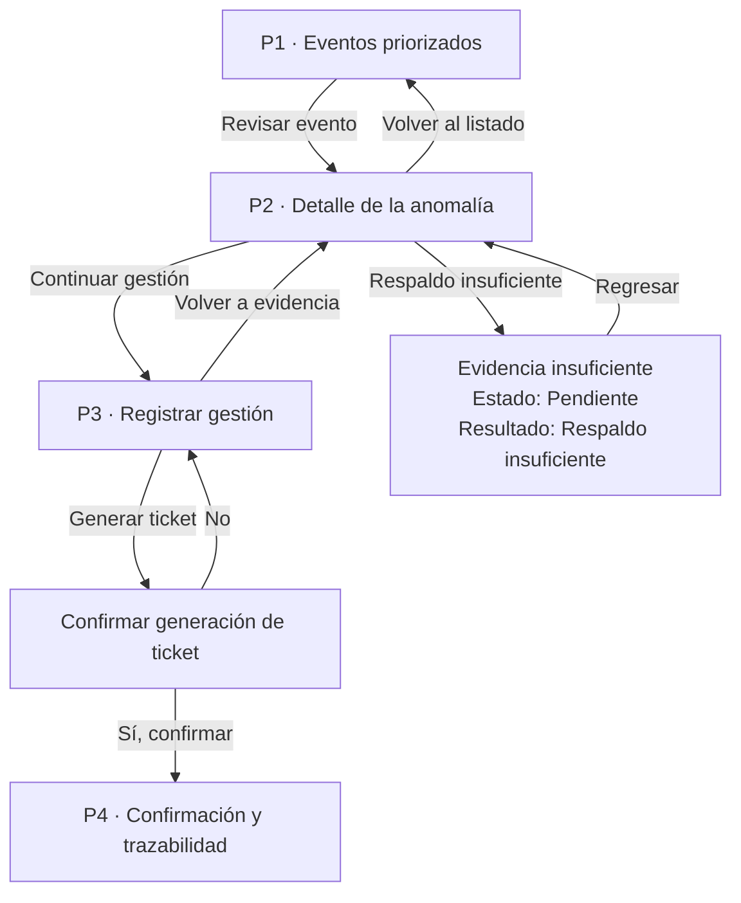

# Prototipo navegable · Aqua Trace

**Enlace al prototipo:**  
https://www.figma.com/design/hiJAFk97pvH1wxw52zjUej/Wareframe-Aqua-Trace?node-id=0-1

El prototipo representa el flujo principal de revisión y gestión de anomalías detectadas en el monitoreo de pozos.

La navegación permite revisar eventos priorizados, consultar su evidencia, registrar una decisión y mantener la trazabilidad de la gestión.

## Sistema mínimo de diseño · A2

Para mantener consistencia entre las pantallas del flujo principal se utiliza el siguiente sistema mínimo:

- **Texto principal:** 24 px para títulos de pantalla.
- **Texto de contenido:** 16 px para información, etiquetas y controles.
- **Color de acción:** azul para botones y acciones principales.
- **Color de alerta:** rojo para advertencias o condiciones que requieren atención.
- **Unidad base de espaciado:** 8 px.

Los estados del sistema se presentan mediante texto además del apoyo visual del color, evitando que la interpretación dependa únicamente de este último.

## Pantallas principales

El flujo evaluado está compuesto por cuatro pantallas principales asociadas a las historias de usuario del proyecto.

### P1 · Eventos priorizados

**Historia:** HU-02

Permite visualizar los eventos detectados y ordenarlos según su prioridad.

La pantalla presenta información como:

- código y nombre del pozo;
- tipo de anomalía;
- prioridad;
- fecha y hora de detección;
- fecha límite de gestión;
- identificador del evento.

La acción principal permite seleccionar un evento y revisar su detalle.

### P2 · Detalle de la anomalía

**Historia:** HU-01

Permite revisar los antecedentes del evento antes de tomar una decisión.

Se muestran, entre otros antecedentes:

- identificador del evento;
- código del pozo;
- prioridad;
- estado;
- tipo de anomalía;
- criterio de detección;
- fecha de detección;
- evidencia disponible;
- valor observado;
- umbral correspondiente;
- comparación entre fuentes DGA y LI-COR.

El analista puede volver al listado o continuar hacia el registro de la gestión.

### P3 · Registrar gestión

**Historia:** HU-03

Permite registrar la decisión adoptada por el analista.

Los principales campos utilizados son:

- `id_evento`;
- `fecha_hora_limite_gestion`;
- `accion`;
- `resultado`;
- `comentario`.

Los campos `accion` y `resultado` representan opciones previamente definidas en la estructura de datos, mientras que `comentario` permite justificar la decisión adoptada.

La decisión sobre generar o no un ticket permanece en el analista.

### P4 · Confirmación y trazabilidad

**Historia:** HU-04

Permite comprobar que la decisión realizada quedó registrada y asociada al evento correspondiente.

Cuando existe un ticket, la pantalla presenta información como:

- código del ticket;
- fecha de creación;
- estado;
- motivo;
- acción realizada;
- resultado;
- comentario asociado.

Desde esta etapa el usuario puede volver al flujo de seguimiento.

## Mapa de navegación · A3

### Camino principal

**P1 → P2 → P3 → Confirmación → P4**

El analista selecciona una anomalía priorizada, revisa su evidencia, registra la gestión, confirma la generación del ticket cuando corresponde y finalmente revisa la trazabilidad de la decisión.

### Camino alternativo 1 · Evidencia insuficiente

Este camino se deriva del criterio de aceptación de HU-01.

Cuando los antecedentes disponibles no permiten continuar con seguridad, el prototipo presenta:

**Estado: Pendiente**  
**Resultado: Respaldo insuficiente**

junto al mensaje:

**“Se requieren antecedentes adicionales para continuar.”**

El usuario puede regresar al flujo de revisión sin generar un ticket.

### Camino alternativo 2 · Cancelar generación de ticket

Al llegar a la confirmación de generación de ticket, el usuario puede seleccionar **“No”**.

Esta acción devuelve al usuario a la pantalla de registro de gestión, permitiendo revisar o modificar la decisión antes de continuar.

Este camino evita que una confirmación accidental genere una gestión no deseada.

## Estados de interfaz · A4

El prototipo considera que una interfaz de monitoreo debe comunicar claramente el estado de la información.

Los estados definidos para la implementación son:

| Estado | Mensaje esperado |
|---|---|
| Con datos | Se muestran los eventos disponibles según los filtros seleccionados. |
| Vacío | No se encontraron anomalías para los filtros seleccionados. |
| Cargando | Cargando eventos… |
| Error | No fue posible cargar los eventos. Intenta nuevamente. |

Los estados de eventos como **Pendiente**, **En revisión**, **Gestionado** y **Cerrado** deben mostrarse siempre mediante texto y no únicamente mediante color.

## Registro de decisiones · A5

| Pantalla | Historia | Criterio que verifica | Simulado | Funcional |
|---|---|---|---|---|
| P1 · Eventos priorizados | HU-02 | El analista puede visualizar y seleccionar eventos priorizados para revisión. | Datos de eventos y filtros. | Navegación hacia el detalle del evento. |
| P2 · Detalle de la anomalía | HU-01 | El analista puede revisar anomalía, criterio de detección, evidencia y comparación de fuentes antes de decidir. | Datos DGA, LI-COR, evidencia y umbrales. | Navegación hacia gestión, retorno al listado y camino de evidencia insuficiente. |
| P3 · Registrar gestión | HU-03 | El analista puede registrar la acción, resultado y comentario asociados al evento. | Registro de la decisión y generación del ticket. | Retorno a evidencia y avance hacia confirmación. |
| P4 · Confirmación y trazabilidad | HU-04 | El analista puede verificar que la gestión quedó registrada y asociada al ticket cuando corresponde. | Código, estado y antecedentes del ticket. | Continuación del flujo y navegación hacia otras etapas. |

## Alcance del prototipo

Para la evaluación del Avance 5 se consideran como flujo principal las pantallas P1, P2, P3 y P4.

El archivo Figma contiene además pantallas complementarias, como inicio de sesión, inicio, perfil de usuario, recuperación de contraseña, seguimiento y cierre de sesión. Estas pantallas representan contexto adicional de la solución, pero no forman parte del flujo principal evaluado en este avance.
